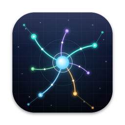
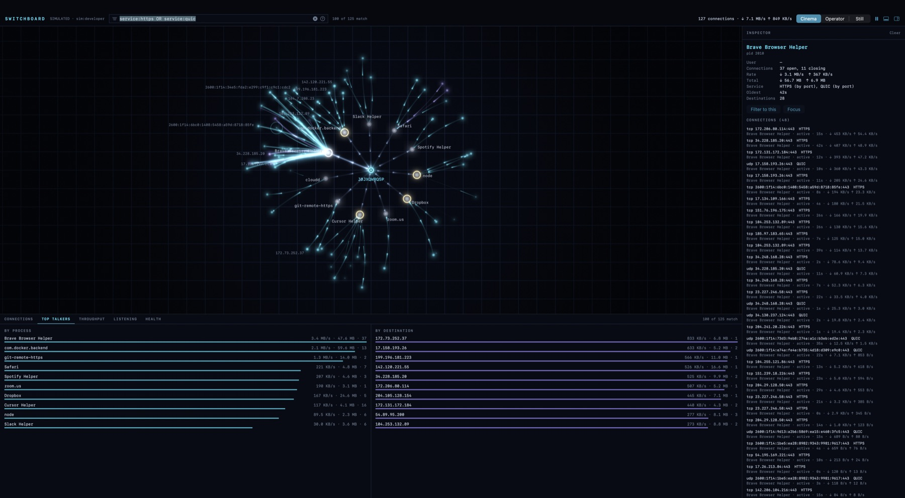
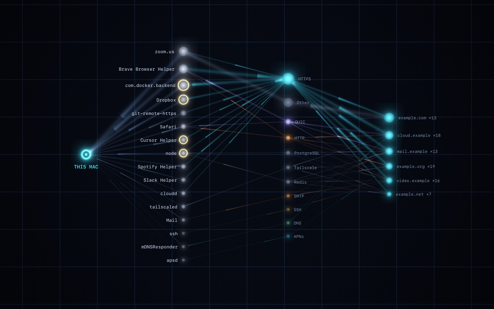
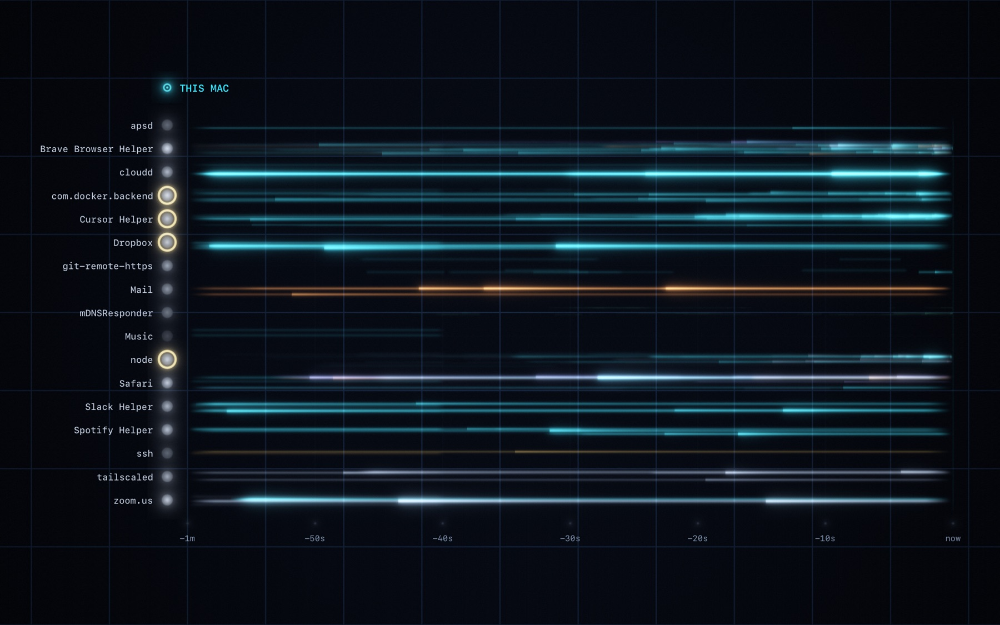
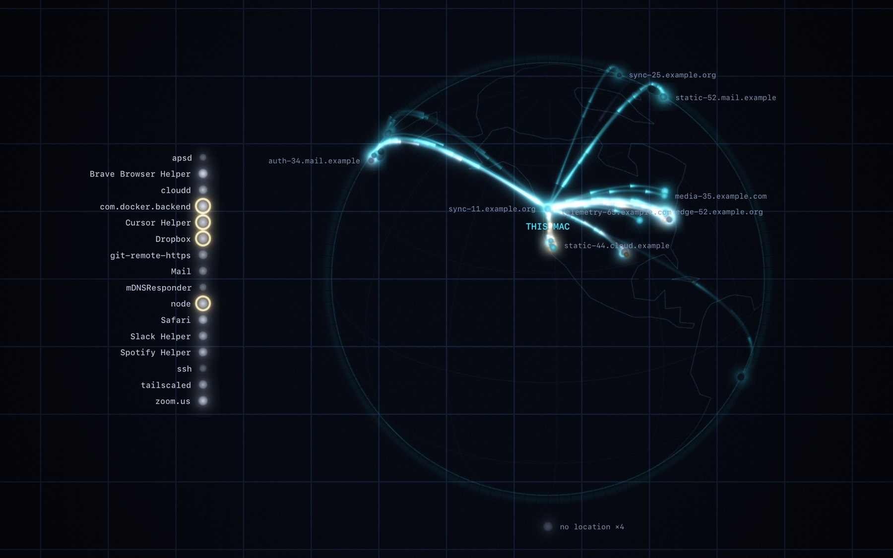
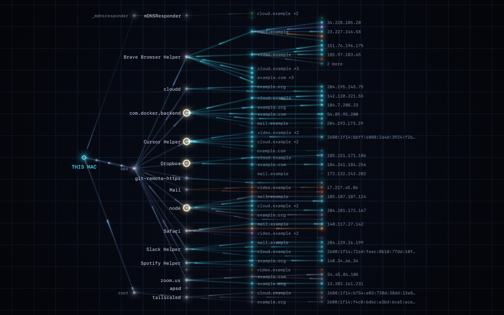
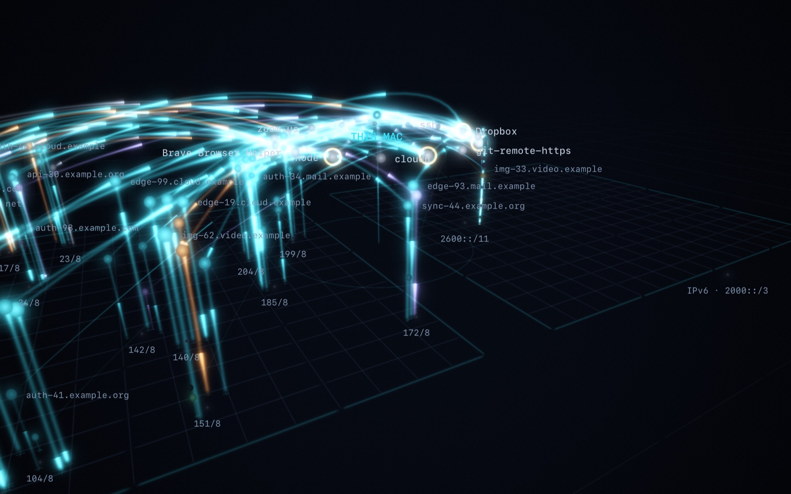
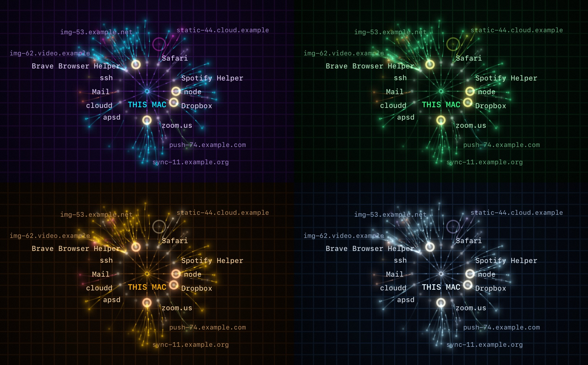

# Switchboard

A live picture of every network connection on your Mac: which program is talking, to whom, how much, and for how long.



Switchboard draws this Mac in the centre, the programs using the network around it, and the places they talk to beyond. Lines carry pulses in proportion to traffic. Underneath is a console: tables, a filter language, a timeline you can drag backwards, and a searchable log of everything it has seen.

It is built to be watched on a wall and to be useful at a desk. **Website: [robert-mcdermott.github.io/switchboard](https://robert-mcdermott.github.io/switchboard/)**

> **Status: beta. The latest release is [version 0.1.1](https://github.com/robert-mcdermott/switchboard/releases/tag/v0.1.1), a fix to the installer, from 24 November 2026**, for Macs with Apple silicon. The first release, 0.1.0, came out on 21 November. It installs with one command ([Install](#install), below); no clone, Xcode, or Swift is needed. Milestones 0 to 7 of 8 are built, and the hardening of 8 is underway. It is used daily on the author's Mac, but has only been run on macOS 27, and it is not signed with a Developer ID or notarised. See [docs/ROADMAP.md](docs/ROADMAP.md).

## What it shows

- **Every connection, by program**: process, user, remote address and port, bytes and rate each way, age, TCP state, round-trip time.
- **Names**: hostnames from the DNS answers and TLS handshakes it sees, never from lookups of its own unless you turn that on.
- **Places and owners**: country, city, and network owner for each destination, from a free database it downloads when you ask.
- **Trust**: who signed each program. Unsigned and tampered programs get a red ring; ad hoc ones an amber ring.
- **History**: a log in SQLite that you can search with the same filter you use live, replay in the graph, and export as CSV or JSON lines.
- **New things**: destinations this Mac has never talked to before are ringed and listed.

## Six layouts

| Key | Layout | Shows |
|---|---|---|
| **1** | Constellation | This Mac, its processes around it, destinations beyond |
| **2** | Flow | Left to right by volume: processes, what the traffic is, who owns the far end |
| **3** | Lanes | One row per process, a bar for each connection over time |
| **4** | Globe | Destinations where they are, with arcs from this Mac (needs the location data below). Drag to turn it; **0** turns it back home |
| **5** | Hierarchy | Account, process, domain, address, as a tree |
| **6** | Cyberspace | The address space as a floor in 3D, a tower on each destination's address, flown through |

The same things are selectable in each, and a selection carries across when you switch.









**Cyberspace** lays the whole address space out as a floor. Addresses run along a Hilbert curve, so every prefix is a compact block (an IPv4 /8 is one cell of a 16 × 16 grid) and the same address is always in the same place: cloud providers become districts you learn to recognise. Each destination is a tower on its address, as tall as the bytes it has carried and as bright as its rate. This Mac floats over the gap between the IPv4 and IPv6 squares with its processes in a ring, and beams arc from each process to its towers. It orbits slowly by itself; drag to orbit, scroll or pinch to move in, **W A S D** or the arrows to fly, double-click a tower to fly to it, **0** to come home.



Six colour themes, cycled with **T**: Standard, the four below (Neon, Phosphor, Amber, Ice), and Colour-safe, whose hues stay distinct with the common colour-vision deficiencies.



## What it does not do

It watches; it never blocks, changes, or injects anything. It sends nothing anywhere: no telemetry, no update check, no crash reports. It keeps no packet contents. It touches the network itself only when you ask: to download the location databases, and for optional reverse DNS lookups, which are off unless you choose them.

## Install

Switchboard needs a Mac with Apple silicon (M1 or later) and macOS 15 or later. In Terminal:

```bash
curl -fsSL https://github.com/robert-mcdermott/switchboard/releases/latest/download/install.sh | bash
```

It puts Switchboard in /Applications and asks two questions: whether to install the collector (Full mode, below; it asks for your password), and whether to download the location databases (about 130 MB from db-ip.com). Run the same command again to update. To read the script before running it:

```bash
curl -fsSL https://github.com/robert-mcdermott/switchboard/releases/latest/download/install.sh -o install.sh
```

```bash
less install.sh
```

```bash
bash install.sh
```

You can also download the zip from the [releases page](https://github.com/robert-mcdermott/switchboard/releases) and drag Switchboard.app to Applications. Switchboard is not signed with a Developer ID or notarised, so the first time you open a copy downloaded with a browser, macOS refuses; open System Settings ▸ Privacy & Security and click **Open Anyway**. The installer avoids this: `curl` does not mark what it downloads as quarantined, and the installer checks the zip against the SHA-256 published with the release.

To remove everything:

```bash
curl -fsSL https://github.com/robert-mcdermott/switchboard/releases/latest/download/install.sh | bash -s -- --uninstall
```

The [guide](docs/GUIDE.md#installing) has the installer's options.

## Build from source

You need the Xcode command line tools with Swift 6. There are no other dependencies, and nothing is fetched at build time.

```bash
git clone https://github.com/robert-mcdermott/switchboard.git
```

```bash
cd switchboard && scripts/bundle.sh
```

```bash
open build/Switchboard.app
```

`bundle.sh` builds a release and assembles `build/Switchboard.app`, signed ad hoc, with its icon and the collector, `sbctl`, and the scripts that install the collector and download the location data inside it. There is no Xcode project. `scripts/release.sh` builds a release zip and its installer; `scripts/release.sh --publish` puts them on GitHub.

To see it without touching your own traffic, run it on simulated data:

```bash
build/Switchboard.app/Contents/MacOS/Switchboard --source sim:developer
```

## Two modes

**Standalone** needs no privilege and no setup. It sees the connections of your own account, which is most of what a single-user Mac does, and shows addresses rather than hostnames.

**Full** adds a small collector that runs as root. With it Switchboard sees every account's connections and learns hostnames from DNS and TLS. The app notices the collector and switches on its own.

The installer offers to install the collector, and the app's Health tab has **Install Collector…** and **Remove Collector…**; macOS asks for an administrator's password, which Switchboard never sees. From a clone of the repository:

```bash
sudo scripts/install.sh
```

```bash
sudo scripts/uninstall.sh
```

The install script says exactly what it copies and where; the uninstall script reverses each step. The collector is one dependency-free binary that reads, publishes to a local socket only administrators can open, and changes nothing. The app carries its own copy, so the Health tab offers to update the collector when the two differ.

## On a wall

The **Workspace** menu holds named arrangements of layout, filter, and panels. Three come with it (NOC Wall, Privacy Audit, Developer) and you can save your own. Kiosk mode (**K**, **Esc** to leave) goes full screen with nothing but the graph. To start a display that way:

```bash
/Applications/Switchboard.app/Contents/MacOS/Switchboard --workspace "NOC Wall" --display 2
```

Other keys: **Space** pauses, **/** jumps to the filter, **P** changes how lively the picture is, **E** keeps ended connections on screen, **L** shows or hides traffic that never leaves this Mac, **T** changes the colour theme, **B** and **I** show and hide the panels and the inspector, **0** resets the view.

## Location data

Country, city, and network owner come from the free DB-IP Lite databases, about 130 MB. Switchboard downloads them only when you ask: the installer offers to, and Settings ▸ Location has **Download Location Data**, which also fetches each month's new edition. From a clone, `scripts/fetch-geoip.sh` does the same. The data is *IP Geolocation by DB-IP*, licensed CC BY 4.0.

The globe also needs to know where this Mac is. It guesses from the time zone; set it exactly in Settings ▸ Globe. Switchboard never asks the network.

The globe's coastlines are Natural Earth's 1:110m coastline (naturalearthdata.com, public domain), built into the app: there is nothing to fetch. `scripts/make-coastline.swift` regenerates them.

## Filtering

One language filters the graph, the tables, and the log.

```
process:Slack rate_out>100KB/s
user:root service:SSH
r_port:443 NOT host:*.apple.com
age>1h bytes<10KB
class:public country!=US signing=unsigned
remote:10.0.0.0/8 OR tag:office
```

Terms are `field:value` (contains), `=`, `!=`, and `<` `>` for numbers; combine them with `AND`, `OR`, `NOT`, and brackets. Values understand units (`KB/s`, `MB`, `h`), `*` wildcards, and networks in CIDR form. A bare word matches process, hostname, service, and address. The **?** beside the filter field lists every field.

Separately, the laptop button (**L**) shows or hides connections that never leave this Mac: loopback, and programs reaching this Mac by its own address. On a developer's Mac, containers and local servers can be most of the traffic. On shows everything; off shows only traffic to other machines, in the graph, the tables, and the log search alike.

## The command line tool

`sbctl` reads the same engine without the window, and is how most of Switchboard is tested. It travels inside the app:

```bash
/Applications/Switchboard.app/Contents/MacOS/sbctl top
```

From a clone, `swift build && .build/debug/sbctl`.

| Command | What it does |
|---|---|
| `sbctl top` | Live connections, busiest first |
| `sbctl dump` | The engine's whole model as JSON |
| `sbctl log query "process:Safari bytes>1MB" --since 7d` | Search the log |
| `sbctl log export` | Write the log as CSV or JSON lines |
| `sbctl geo 8.8.8.8` | Where an address is and whose it is |
| `sbctl trust /Applications/Safari.app` | Who signed a program |
| `sbctl verify` | Check the engine against `netstat` and known traffic |

## How it works

| Part | Role |
|---|---|
| `SwitchboardCore` | The engine: connections, rates, names, the filter language. No system calls; fully testable |
| `SwitchboardSources` | Where data comes from: the system's network statistics, the kernel socket list, packet capture, process details |
| `switchboardd` | The optional root collector |
| `SwitchboardStore` | The log, on the SQLite that ships with macOS |
| `SwitchboardRender` | The graph, in Metal |
| `SwitchboardApp` | The window, in SwiftUI |
| `sbctl` | Diagnostics |

Some of the data comes from interfaces Apple does not document (the NetworkStatistics framework, the kernel socket list, PKTAP). Each is isolated, optional at run time, and reported on the Health tab, so a macOS update that breaks one costs detail rather than the app.

The full design is in [docs/SPEC.md](docs/SPEC.md). What was measured, and what was not, is written up per milestone in [docs/spikes](docs/spikes).

## Documentation

- [The website](https://robert-mcdermott.github.io/switchboard/): the guide, searchable, with pictures.
- [docs/GUIDE.md](docs/GUIDE.md): installing, using, and troubleshooting.
- [docs/SPEC.md](docs/SPEC.md): the design.
- [docs/ROADMAP.md](docs/ROADMAP.md): what is built and what is next.
- [docs/spikes](docs/spikes): what each milestone measured, and what it did not.

## Tests

```bash
swift test
```

```bash
scripts/snapshots.sh
```

The second renders reference scenes and compares them with golden images.

## Known limits

- Without the collector, roughly 5 to 8 percent of your own account's sockets are not reported by the system.
- The app uses 12–17% of a core in the Operator profile, over its 10% budget.
- It has run for 2.5 hours at a stretch, not days. Memory with an hour of history was about 315 MB and still creeping up slowly.
- Kiosk mode has not had a long unattended run, and moving between displays is untested.
- QUIC connections get names from DNS only, and encrypted DNS, ECH, and Private Relay all reduce what any observer on the machine can name.

## Licence

Copyright 2026 Robert McDermott. Licensed under the [Apache License, Version 2.0](LICENSE).
