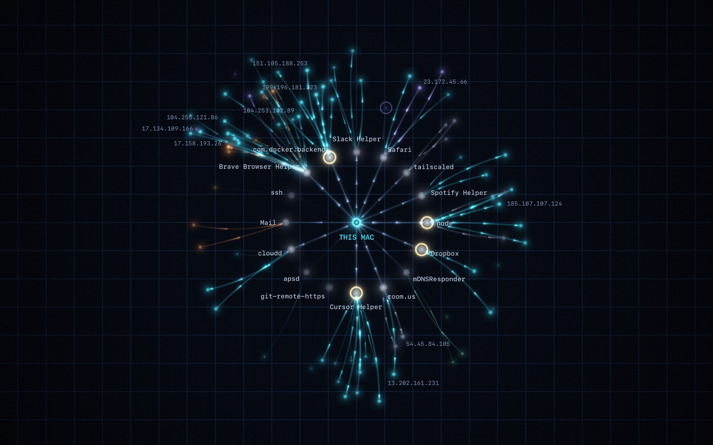
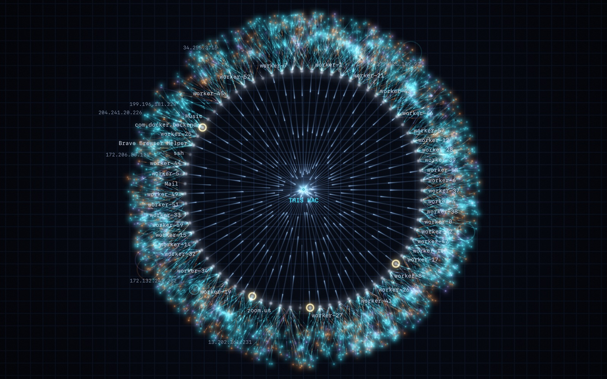

# M2 findings

"First light": the Constellation graph running on real traffic. Measured on macOS 27.2.1 (26B131), Apple M4, 120 Hz display, release build.



```bash
scripts/bundle.sh && open build/Switchboard.app
```

```bash
open build/Switchboard.app --args --source sim:stress
```

## Exit criteria

| Criterion (ROADMAP M2) | Result |
|---|---|
| Launch to live graph in under two seconds, no setup | **Met.** 0.60–0.76 s from process start to the first frame with real connections in it |
| 60 fps at the 5k stress scenario | **Met on average, not as a floor.** 110 fps mean with 2,051 nodes and 2,050 edges; the slowest 1% of frames take 20 ms and the worst 25 ms. Not tested at 5,000 nodes |
| A first-time viewer can tell which process is busiest | **Not tested.** Needs a person who has not seen it |

## Measurements

Five seconds each, after three seconds to settle, in a 5120 × 2756 pixel window:

| Scene | Nodes | Edges | Frames/s | p99 frame | Worst frame | GPU mean | GPU p99 |
|---|---|---|---|---|---|---|---|
| This Mac, live | 72 | 78 | 118.6 | 16.3 ms | 18.6 ms | 3.3 ms | 6.4 ms |
| Simulated, Still profile | 103 | 102 | 119.0 | 15.9 ms | 18.7 ms | 3.4 ms | 5.8 ms |
| Simulated stress | 2,051 | 2,050 | 109.5 | 20.2 ms | 25.4 ms | 6.6 ms | 10.1 ms |

Shaders compile in about 90 ms on the first launch of a build and 1–3 ms afterwards.

**One optimisation mattered.** The first stress measurement was 80 fps with the GPU at 12.4 ms. Every node was drawn on a quad large enough for its "new arrival" ring, at least 136 pixels square, and with two thousand nodes that area was most of the GPU's work. Sizing the quad for the ring only while a node is actually arriving took the GPU to 7 ms and the frame rate to 115.

## Verification

| Check | Result |
|---|---|
| Golden images | Three scenarios (quiet, developer, stress) rendered headlessly; repeated runs are pixel-identical (difference 0.000) |
| Golden test catches changes | The quad-size optimisation above shifted the stress image by 2.46 of 255 and the script failed until the new image was reviewed and accepted |
| Tooltip against the engine | At t = 20 s of the developer scenario, the tooltip for one process and `sbctl dump --at 20` agree exactly: 33 open and 14 closing connections, 2.1 MB/s in, 252 KB/s out, 60.0 MB and 7.3 MB totals, 26 destinations |
| Unit tests | 55 passing, 14 of them new for placement, scene building, picking, and tooltips |

```bash
scripts/snapshots.sh
```

**Not verified by hand:** pointer and keyboard handling. Picking and tooltip content are unit-tested, and the code that turns mouse movement, scrolling, pinching, and key presses into those calls compiles and is wired up, but nobody has yet moved a mouse over the running app and checked that hovering, panning, zooming, and the space, P, and 0 keys behave.

## What was built

| Piece | Where |
|---|---|
| Scene model, placement, relaxation, picking, tooltips | [`GraphController.swift`](../../Sources/SwitchboardRender/GraphController.swift) |
| Shaders: field, edges with pulses, nodes, bloom, tone map, labels | [`Graph.metal`](../../Sources/SwitchboardRender/Shaders/Graph.metal) |
| Renderer, drawing to any texture | [`GraphRenderer.swift`](../../Sources/SwitchboardRender/GraphRenderer.swift) |
| Label and app-icon atlases | [`Atlases.swift`](../../Sources/SwitchboardRender/Atlases.swift) |
| View, camera, pointer and keyboard input | [`GraphView.swift`](../../Sources/SwitchboardRender/GraphView.swift) |
| Headless rendering and image comparison | [`Headless.swift`](../../Sources/SwitchboardRender/Headless.swift), [`scripts/snapshots.sh`](../../scripts/snapshots.sh) |
| App: in-process engine, HUD, tooltip, profiles, pause | [`Sources/SwitchboardApp`](../../Sources/SwitchboardApp) |

Controls: hover for detail · drag or two-finger scroll to pan · pinch or ⌘-scroll to zoom · space to pause · P to cycle Cinema, Operator, Still · 0 to reset the view. The app starts in Still when the system's Reduce Motion setting is on.

## Design decisions made while building

**Placement is computed, not simulated.** SPEC §9.5 called for a Barnes–Hut force simulation on a background thread. What was built instead gives every node an anchor that is a pure function of its name or address: processes sit evenly around a ring in an order fixed by their names, and each destination sits in the sector of the process that uses it most. A short relaxation then separates overlapping nodes. This is what delivers "position is memory": the same process is in the same direction on every launch, which a force simulation cannot promise. It is also deterministic, which the golden images depend on, and cheap enough to run on the main thread (it stops once nothing is moving).

**Two things had to change after seeing real pictures.**

- *Ring spacing.* The first version kept each process at its hashed angle and only pushed close neighbours apart. Processes bunched up, and sixty processes named `worker-1` to `worker-60` landed in two clumps because the hash barely separated names differing in their last character. The hash now ends with a full mixing step, and the ring is spaced evenly in hash order.
- *Brightness.* Edges add light where they overlap, so a process with hundreds of destinations burned out to white. Edge brightness now falls with the number of destinations a process has, and edges held at their minimum width when zoomed out are drawn fainter. A fan of hundreds reads as texture.



**Loopback connections have no node.** On a real machine many processes talk to `127.0.0.1`, and a single shared node for it pulled lines from every corner of the graph. Loopback traffic now counts toward the process and its line to the centre, and the tooltip reports it separately.

**Reconnecting processes are not re-announced.** A process that opens a connection every few seconds kept leaving and rejoining the graph, flashing its arrival ring each time. The graph remembers a node for a minute after it leaves.

**Labels are placed outward and culled.** Each label is pushed away from the centre into open space; one that would cover a more important label is dropped. The host and the busiest processes win.

**Counters refresh at 2 Hz while the app is frontmost, 1 Hz otherwise,** following the M1 finding that asking for counters is what costs CPU.

## Differences from the spec, stated plainly

| SPEC said | Built | Why |
|---|---|---|
| Barnes–Hut on a background thread | Computed anchors plus grid relaxation on the main thread | Above |
| Picking through the layout's quadtree | A linear scan | A few thousand distance checks per mouse move cost microseconds |
| A separate instanced particle pass | Pulses computed in the edge fragment shader | Same picture, no per-particle data at all |
| 16-bit float target with EDR highlights | 16-bit float scene, tone-mapped to an 8-bit drawable | EDR output is not done yet |
| Tooltip with trust, hostname, ASN, location, 60 s sparkline | Tooltip with everything the engine knows today | Those fields arrive in M4 and M6; the sparkline is not built |

## The missing sockets: a negative result

M1 found that NetworkStatistics never delivers 5–8% of the user's sockets. Every variant the framework exports was tried against ten sockets known to be missing: `NStatManagerAddAllTCPWithFilter`, `NStatManagerAddAllTCPWithOptions`, and `NStatManagerSetFlags` with each single bit from 1 to 64. None revealed any of the ten. `nettop`, which holds the `com.apple.private.network.statistics` entitlement, shows all of them, so the entitlement is the most likely gate and there may be no unprivileged way to see these sockets. Whether root sees them is a question for M4.

## Carried forward

| Item | To |
|---|---|
| A person checks hover, pan, zoom, and keys in the running app | Before M3 |
| The five-second test with someone who has not seen it | M3 |
| Stress test at a true 5,000 nodes; frame pacing so the worst frame stays under 16.7 ms | M3 |
| EDR output on capable displays | M7 |
| Loopback connections drawn as process-to-process edges | M3 |
| Golden images are specific to this GPU and these system fonts | Re-accept after any macOS or hardware change |
