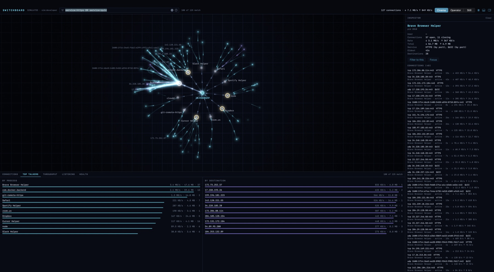

# M3 findings — part one

The operator console. M3 is the largest milestone, so it is being delivered in two parts. This records part one: what is built, how it was checked, and what remains.



```bash
scripts/bundle.sh && open build/Switchboard.app
```

## Built in part one

| Roadmap item | State |
|---|---|
| Filter language: parser and in-memory evaluator | Done |
| Filter applied to graph and table together | Done; also to Top Talkers and the inspector |
| Window layout: top bar, graph, inspector, panels | Done; inspector and panels can be hidden (I, B) |
| Inspector for processes, destinations, and connections | Done |
| Connections table with configurable columns | Done: 16 columns, sortable, show/hide and reorder from the header |
| Panels: Top Talkers, Throughput, Listeners, Health | Done |
| Focus mode | Done: double-click, or Focus in the inspector or context menu; Esc releases |
| Context menu | Done: Filter to This, Focus on This, Copy Details, Reveal in Finder |
| Menu bar extra | Extended with the top three talkers |

## Still to do in part two

| Roadmap item | Note |
|---|---|
| In-memory time window, keyframes, timeline scrubber | Not started |
| Endpoint clustering and the auto-clustering threshold | Not started |
| Multi-select | Not started |
| Filter autocomplete and saved filters | The field list exists (`FlowFilter.fields`) and drives the help popover; completion is not built |
| Panels: Protocol and Port Mix, Interfaces | Not started |
| Settings beyond the remembered profile | Not started |
| Colour-vision validation and an alternate palette | Not started |
| `nettop`-backed "scan everything once" | Not started |
| Loopback connections as process-to-process edges | Not started |
| A true 5,000-node stress test, and frame pacing | Not started; see below |
| VoiceOver pass; the five-second test | Need a person |

## The filter language

```
process:Slack rate_out>100KB/s
r_port:443 NOT process:*Helper*
age>1h bytes<10KB
remote:10.0.0.0/8 OR remote:192.168.0.0/16
```

23 fields, listed in the help popover beside the filter field. Terms combine with AND unless OR is written; NOT and parentheses work; a bare word matches process name, remote address, or service. Text takes `:` (contains), `=`, `!=`, and `*` `?` wildcards. Numbers take comparisons and units. Addresses take exact values, CIDR networks, and wildcards.

Two behaviours chosen deliberately:

- **A filter that does not parse changes nothing.** The field turns red and says what is wrong, and the last good filter stays in force. A half-typed filter never blanks the display.
- **A flow with no measurement satisfies no comparison on it.** `rtt<50` and `rtt>=0` are both false for a UDP flow, rather than treating "unknown" as zero.

## Verification

| Check | Result |
|---|---|
| Filter unit tests | Text, numbers with units, IPv4 and IPv6 networks, precedence, bare words, 13 error cases |
| Filter against direct evaluation | 300 random expressions, rendered to text and parsed back, agree with evaluating the expression directly on every flow of a simulated machine |
| Graph filtering and focus | 5 tests: only matching flows are drawn; a new filter applies while paused; focus dims everything outside the neighbourhood and stills its pulses |
| The running window | Launched on simulated traffic with a filter and a selection: 100 of 125 connections matched, the graph showed only those, the inspector showed the selected process with its 48 connections, Top Talkers ranked the matching set |
| All tests | 68 passing |
| Golden images | Unchanged |

**Not verified by hand.** As in M2, nobody has driven the pointer and keyboard. The window was checked by launching the app with its state set from the command line (`--filter`, `--select`, `--panel`) and having it save a picture of itself. Clicking, double-clicking, the context menu, sorting and rearranging table columns, the keyboard shortcuts, and typing in the filter field are wired up and compile, and are untested in use.

## Findings

**The console costs frames.** With the panels open the graph runs at 103–114 fps where M2 measured 119, and the slowest 1% of frames take about 26 ms instead of 16. The graph itself is unchanged; the extra time is SwiftUI re-laying-out the chrome when the once-a-second data arrives. This is the frame-pacing work already carried from M2, now with a clear cause.

**macOS will not let a script photograph the window.** `screencapture` needs Screen Recording permission that a build tool does not have. The app now saves a picture of its own window when run with `--measure`: AppKit draws everything except the Metal view, and the graph is pasted in from a frame the renderer saved. Text floating over the graph is lost in that picture, which is acceptable for checking layout.

**The table is capped at 1,500 rows,** keeping the busiest, with a notice when the cap applies. The filter is the way to reach the rest.

## Using it

| Do this | To |
|---|---|
| Type in the filter field, or press `/` | Narrow everything to matching connections |
| Click a node, a line, or a table row | Pin it in the inspector |
| Double-click a node or line | Focus: dim everything not connected to it. Esc releases |
| Right-click a node or line | Filter to it, focus on it, copy its details, reveal the process in Finder |
| Click a column header; right-click the header | Sort; show, hide, and reorder columns |
| `I`, `B` | Hide or show the inspector and the panels |
| Space, `P`, `0` | Pause, cycle profile, reset the view |
