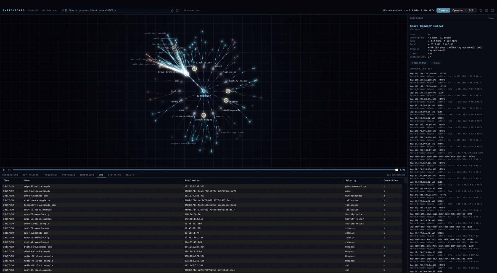

# M4 findings

The collector and Full mode, in two parts. Part one is the privileged daemon, the protocol it speaks, and the app following it automatically. Part two is packet capture: hostnames and observed services.



Measured on macOS 27.2.1 (26B131), Apple M4. The automated checks below ran with the collector unprivileged on a temporary socket. **The root run was done by the owner on 2026-11-21:** installed with `sudo scripts/install.sh`, used the app in Full mode and saw processes from every account, then removed it with `sudo scripts/uninstall.sh`. That confirms the install path and Full mode work end to end; the specific measurements in "What still needs measuring as root" were not taken.

```bash
sudo scripts/install.sh
```

```bash
sudo scripts/uninstall.sh
```

## Roadmap items

| Item | State |
|---|---|
| `switchboardd`: socket publisher, peer checks, backpressure | Done |
| Wire codec with round-trip and fuzz tests | Done |
| `sbctl tap` | Done |
| App-side client, automatic Standalone ⇄ Full switching, reconnect | Done |
| Kernel socket list as the collector's cross-check | Done as a source; its root coverage not yet measured |
| `scripts/install.sh` and `uninstall.sh` | Done; run by the owner |
| The install command offered in the app | Done, in the Health panel, with a Copy button |
| Collector section in Health | Mode, what it means, and each collector source's status |
| Packet capture with filtering in our own code | Done; run as root by the owner |
| DNS answers, with the process that asked | Done: 44 read in the root run |
| TLS server names, including handshakes that span segments | Done: 76 read in the root run, 16 of them across segments |
| Observed service labels: TLS, QUIC, DNS | Built |
| Hostname modes Off and Passive; source shown with each name | Done |
| DNS Activity panel | Done |
| Attribution of very short flows from SYN and FIN packets | Not built (see below) |
| Clustering by domain | Not built |

## Verification

| Check | Result |
|---|---|
| Codec round trip | Every message type, with all optional fields present and absent, decodes to what was encoded |
| Codec truncation | Every message cut at every length fails cleanly |
| Codec fuzzing | About 8,000 corrupted and random bodies: none crashes; a count larger than the message is refused before anything is allocated |
| Stream framing | Frames are recovered identically whether bytes arrive 1, 2, 3, 7, or 64 at a time |
| Collector and client over a real socket | A client that connects late is brought up to date, and its engine ends with the same connections and the same byte totals as one fed directly |
| Collector stops | The client notices and reports itself disconnected |
| Client leaves | The collector drops it |
| Second collector on the same socket | Refused |
| Wrong protocol version | Refused with the reason |
| Garbage instead of a hello | Refused; never registered as a client |
| The real daemon, unprivileged | `sbctl tap` and `sbctl top --source collector:…` both work against it; the socket is mode 0600; it is removed on exit |
| The app with the collector running | Mode reads "FULL · collector running as uid 501", 118 fps |
| The app with the collector killed at five seconds | Back in "STANDALONE · your processes" by the time it was measured, still drawing |
| The app with no collector | Standalone, as before |
| Unit tests | 104 passing |

## Part two: what was verified, and how

Capture needs root, so none of it could be run during development. Three things stood in for that, before the owner's root run below confirmed it on real traffic:

- **The packet layout is known to be right.** The M0 probe, run as root on this machine, found the PKTAP header at exactly the length declared, and read DNS answers and TLS names from live packets with the same parsers.
- **The inspector is tested on synthetic packets** built in that verified layout: Ethernet, loopback, and raw link types; IPv4 and IPv6; DNS answers with and without a delegating process; TLS hellos in one segment and split across two, three, and five; QUIC detected once per connection; interleaved connections kept apart; fragments, plain data, and unrecognised headers dismissed; every truncation and three thousand packets of noise survived.
- **The simulator invents hostnames,** so everything downstream of capture runs here: names through the engine, across the collector's socket to a client that connects after the lookups happened, and into the graph, the table, and the DNS panel.

| Check | Result |
|---|---|
| Unit tests | 124 passing, 20 of them new for this part |
| Names through the collector | A client connecting after every lookup still names all of its connections |
| The running window | 103 DNS rows, hostnames as graph labels and in the table |
| Unprivileged daemon | Starts without capture and says so: "packet capture unavailable: needs root" |

## The root run

The owner installed the collector and used the app on real traffic on 2026-11-21. The Health panel read:

```
FULL · every account, via the collector
nstat: 220 sockets tracked, 2143 seen, 7 updates unreadable
kernel: 207 sockets
capture: 20583 packets, 44 DNS answers, 76 TLS names (16 across segments), 4 QUIC
76 connections · 112 listening sockets (38 exposed) · 125 processes
117 frames/s · slowest 1% of frames 22.6 ms · GPU 2.7 ms · 102 nodes · 119 lines
```

| Question | Answer |
|---|---|
| Does live capture start, and are DNS answers and TLS names read? | Yes: 44 DNS answers and 76 TLS server names from 20,583 packets |
| How many TLS names needed more than one segment? | 16 of 76, about one in five. The reassembly is needed, and the 256-byte snap length in the original spec would have lost those names |
| Is the PKTAP header still as declared? | Yes. The line would report packets with an unrecognised header, and reports none |
| Are any packets dropped? | None reported |
| Does the kernel socket list work as root inside the collector? | Yes: 207 sockets |
| Does the app hold its frame rate in Full mode? | 117 frames a second |

Still open:

| Question | Note |
|---|---|
| What does inspecting every packet cost under heavy traffic? | This run was ordinary use. Measure `switchboardd` during a large download |
| Do NetworkStatistics and the kernel list together reach 100% of `netstat`? | NetworkStatistics was tracking 220 sockets and the kernel list 207, but the two count differently (the kernel list leaves out sockets it is only holding closed), so this does not settle it |
| What are the 7 unreadable updates? | Unprivileged there is one, an empty placeholder. As root there are more; worth a look at what they are |
| Is a non-administrator refused? | Not tested |

## Not built

**Attribution of very short flows from packets.** The roadmap had capture attribute connections too brief for polling, by watching SYN and FIN. M1 then measured NetworkStatistics catching 30 of 30 connections lasting 10 to 100 ms, because it reports opens as events. Building a second, packet-derived flow source to cover a gap that measurement did not find would add a lot of code to the root process for no shown benefit. If the burst test shows connections being missed, this is the fix.

**Clustering by domain.** Hostnames now exist; grouping destinations by registered domain is not done.

**Active reverse lookups** remain in M6, so Standalone mode shows addresses only.

## Design decisions

**The engine stays in the app; the collector forwards what its sources see.** SPEC §5.1 put the flow engine in the daemon and had it publish flow deltas. What was built has the daemon run the *sources* and publish their observations, and the app run the same engine it always has, fed from the socket instead of from local sources. The reasons:

- The privileged process does less. It gathers and forwards; it does not interpret.
- Everything above the sources is identical in both modes, literally the same code path, so Full mode cannot drift from Standalone.
- Source observations are already a stream of changes, which is what the spec wanted from deltas.

The cost is that two clients each run their own engine. For a single-user desktop tool that is the right trade.

**A client that falls behind is restarted from the present.** Each client has an outbound queue. Past 8 MB the queue is dropped and the client is sent a reset followed by the complete current state. On a reset the client reports everything it knew about as gone, and what is still there follows. Collection never waits for a reader.

**The collector serves administrators, or only its owner.** Running as root it accepts root and members of `admin`, and the socket is `0660 root:admin`. Run by an ordinary user for development it accepts only that user, with the socket `0600`. Everyone's network activity is sensitive, so the default is narrow.

**The only thing a client may send is a hello,** within three seconds and under 4 KB. After that the collector reads from the client solely to learn when it has gone.

**Switching modes restarts the engine, not the picture.** Flows are identified by the source that reported them, so they cannot be carried from local sources to the collector's. The engine starts afresh and refills within a second; the graph keeps every node where it was, because placement depends only on names and addresses.

**Capture reports; the engine decides.** The inspector says what a packet showed: this name resolved to these addresses for this process; this server name was sent between these two endpoints. It does not say which endpoint is ours, because a packet does not know. The engine, which knows the sockets, matches either way round.

**A name carries its source.** A hostname from a TLS handshake belongs to that one connection and wins over DNS for it. A DNS answer names an address for the process that asked, and, failing that, for anyone. The table and tooltips show which it was: "from DNS" or "from TLS".

**Seeing TLS confirms a guess without renaming it.** A connection to port 443 is labelled HTTPS by port. Once a TLS handshake is seen on it, it is still HTTPS, now marked "seen" instead of "by port". TLS on a port with no name of its own is labelled TLS.

**The collector replays recent names.** A client that connects after a lookup would otherwise never learn the name, so the collector keeps the last 4,000 capture observations and sends them with the initial state.

**Unknown message types are skipped.** Capture added a message type. A client now steps over types it does not know, so the collector can gain messages without breaking an older app.

**The kernel socket list reports received bytes as zero.** M1 found its receive counter runs at about twice the true figure. A connection known only from that list shows what it sent and no figure for what it received, rather than a wrong one. Where NetworkStatistics also reports the connection, its numbers are used.

## The protocol

A frame is a four-byte length, a type byte, and a payload. Integers are variable-length; strings carry their length. Eight message types: hello, welcome, refused, events, process, health, reset, capture. The whole codec is one file with no dependencies, [`Wire.swift`](../../Sources/SwitchboardCore/Wire.swift).

```bash
sbctl tap --json
```

prints each event the collector publishes as a line of JSON.
