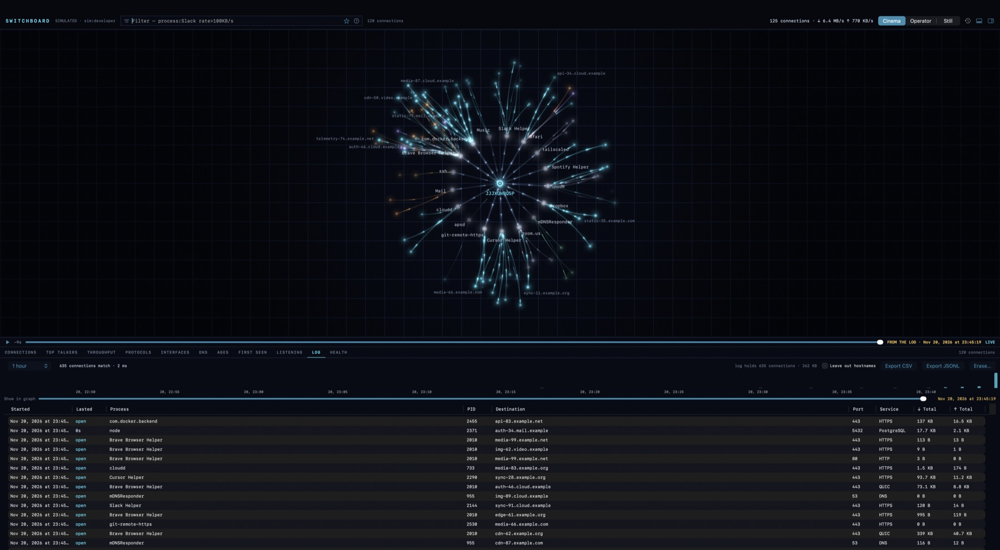

# M5 findings

Memory: everything Switchboard sees is written to a local log and can be searched, replayed, and exported later. Measured on macOS 27.2.1 (26B131), Apple M4, release build.



```bash
sbctl log stats
```

```bash
sbctl log query "process:Safari bytes>1MB" --since 7d
```

## Roadmap items

| Item | State |
|---|---|
| Schema, migrations, writes off the main thread | Done |
| Detail levels | Summary, Standard, and Detailed; chosen in Settings |
| Retention by age and size | Done; applied at launch and hourly |
| Filter compiled to SQL, sharing the live parser | Done, as a prefilter with an exact in-memory pass behind it (below) |
| Log Explorer: query, timeline histogram, result table | Done, as the Log panel, driven by the main filter field |
| "Replay in graph" | Done: drag the slider under the histogram and the graph and tables show that moment from the log |
| CSV and JSONL export, with hostnames optionally left out | Done, in the app and as `sbctl log export` |
| First Seen panel and the ring on new destinations | Done; needs a log that already knows the machine (below) |
| Age Histogram panel | Done, with a list of connections open over an hour yet under 100 KB |
| One-click purge | Done, behind a confirmation |

## Exit criterion

*"Every connection to this address in the last week" answers in under a second and replays in the graph.* **Met.** On seven simulated days, 637,499 connections in a 176 MB log, that query took **57 ms**. Replay from the log is shown above.

## Measurements

Seven simulated days of the quiet scenario, generated in 51 seconds by `sbctl log simulate`.

| Query | Range | Matched | Time |
|---|---|---|---|
| `remote=17.117.171.80` | 7 days | 21,619 | 57 ms |
| `process:Safari` | 7 days | 151,012 | 148 ms |
| `host:*.example.com` | 7 days | 179,623 | 168 ms |
| `r_port:993` | 7 days | 3,024 | 159 ms |
| `bytes>10MB` | 7 days | 6,849 | 179 ms |
| `process:Mail bytes>1MB` | 7 days | 1,082 | **253 ms** |
| everything | 1 hour | 3,804 | 2 ms |
| everything | 1 day | 91,048 | 24 ms |
| `age>1h` | 1 day | 9 | 182 ms |
| `remote:13.0.0.0/8` | 1 day | 3,082 | 184 ms |
| everything | 7 days | 637,499 | 182 ms |

The roadmap's check was "queries under 200 ms" on seven days. Ten of eleven are; one is at 253 ms. Queries that SQL cannot express on its own (ages, rates, networks) cost about 2 microseconds per candidate row, so those over a full week of a busy machine would be slower than anything here; that case was only measured over one day.

**Retention.** Asked to hold the 176 MB log to 60 MB, pruning removed the oldest 437,444 connections and left 55.4 MB.

```bash
sbctl log simulate --db /tmp/week.sqlite --days 7 && sbctl log bench --db /tmp/week.sqlite
```

## Verification

| Check | Result |
|---|---|
| Unit tests | 143 passing, 19 of them new for the log |
| Log against memory, fixed corpus | 34 filters each return exactly the connections that evaluating the filter directly on every logged connection selects |
| Log against memory, random | 150 random expressions with AND, OR, and NOT agree the same way |
| Recording | Every connection the engine opened is written once, with its final totals, hostname, and service |
| Crash safety | Reopening the log closes whatever a previous session left open |
| Engine restart | The same sockets coming back under new ids (Standalone to Full) do not create duplicates |
| A connection shorter than the recording interval | Written once, not once per second while the engine remembers it |
| Replay | A moment rebuilt from the log has the same open connections as the engine had, within the one-second recording interval |
| Export | CSV reads back with the right number of fields per line; JSONL parses line by line with numbers as numbers |
| Non-ASCII text | A process name with accented letters is matched exactly as the live filter matches it |
| The running app | Recorded 635 connections, searched them in 2 ms, and showed a moment from three seconds earlier in the graph |

**Not tried by hand:** the save dialog for exports, the confirmation before erasing, and the first-seen ring, which only appears once the log has a history.

## Findings

**A bug the tests caught.** DNS answers that arrived in the same instant were being logged as one. The log remembered only the time of the last answer written and skipped anything not strictly later, so of twenty names resolved in one tick it kept the first. It now tells them apart by the record's own number.

**The time bounds were the slow part, not the filter.** The first measurements had a fixed cost of about 120 ms on every query, however few rows matched. Two causes:

- The range condition used `COALESCE(closed_at, last_seen)`, which no index can serve. `last_seen` is already the end time of a closed connection, so it is used directly.
- Asking for the oldest and newest times in one statement made SQLite scan the table; asked separately, each is answered from its own index.

A query over the last hour went from 123 ms to 2 ms.

**A bound that excludes nothing is left out.** When the requested range covers the whole log, the range condition is dropped, which frees SQLite to use the index on the remote address or the process instead.

**Counting in SQL, when SQL can be trusted to.** Rebuilding every matching row to count it cost about 2 microseconds a row. When the whole filter can be expressed in SQL, SQL now counts and builds the histogram, and only the rows to be displayed are rebuilt.

## Design decisions

**System SQLite, not GRDB.** The spec named the GRDB library. macOS ships SQLite, and a 120-line wrapper over it was enough, so Switchboard still has no third-party dependencies at all, and nothing had to be downloaded to build it.

**SQL narrows; the filter decides.** The live filter and the log must agree exactly, and SQL's text comparison is not the same as the filter's: `LIKE` ignores case for ASCII only. So the filter compiles to a SQL condition that is allowed to admit too much and never too little, and every row SQL returns is then checked by the real filter. The rules that keep the condition from admitting too little:

- in an AND, a term SQL cannot express is dropped;
- in an OR, one such term means no condition at all;
- a NOT is only compiled over something exact.

Rows containing non-ASCII text are flagged when written, and a query whose range contains one takes the row-by-row path.

**The process is stored with the connection.** The spec had a separate process table. Name, user, and path are written into each connection's row instead: simpler queries, and the log is still readable after a process is long gone.

**A logged connection has an average rate, not a live one.** `rate>100KB/s` against the log compares bytes divided by lifetime.

**A new log flags nothing as new.** On a fresh log every destination is unseen, so the ring would be on everything. Destinations are only remarked on once the log held 200 or more at the start of the session.

**Simulated traffic is not logged** unless a log file is named, so demos never pollute the real history.

**CSV fields are defused.** A value beginning with `=`, `+`, `-`, or `@` is prefixed with an apostrophe, so a process name cannot run as a spreadsheet formula.

## Not built

- **Detail level changes take effect at the next launch,** not immediately.
- **The histogram and the replay slider share the query's range,** so over a long range a single moment is hard to pick precisely. Zooming the histogram is not built.
- **Listeners in a replayed moment.** A moment from the log has connections but no listening sockets; listener events are recorded but not yet replayed.
- **Per-second samples are recorded at the Detailed level and not yet used** by anything.
