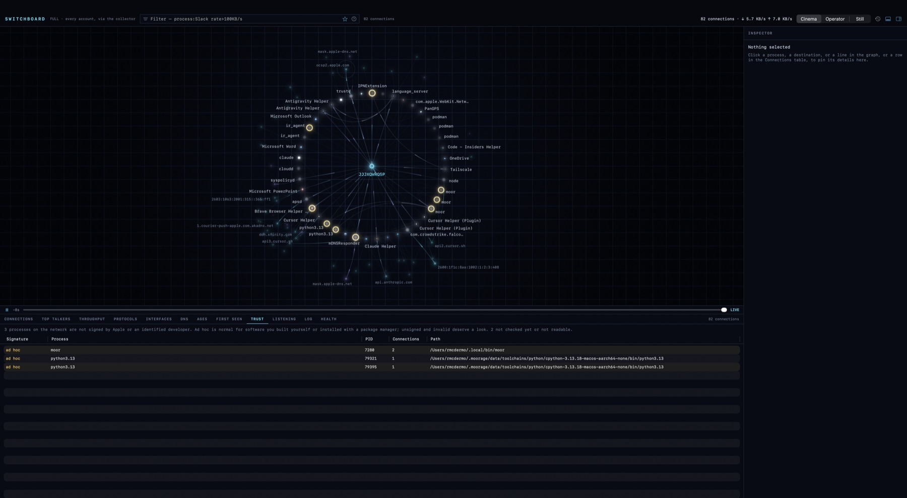

# M6 findings

Enrichment and trust: where a destination is, whose network it is on, which of your own lists it is on, and who signed the program talking to it. Measured on macOS 27.2.1, Apple M4.



```bash
scripts/fetch-geoip.sh
```

```bash
sbctl geo 8.8.8.8 2606:4700::1111
```

```bash
sbctl trust /Applications/Safari.app /opt/homebrew/bin/git
```

## Roadmap items

| Item | State |
|---|---|
| MMDB reader, own implementation | Done. Tested against files built by a writer in the tests, not against MaxMind's published test data (below) |
| `scripts/fetch-geoip.sh` | Written; **not run**. It downloads from db-ip.com, which is yours to do |
| Country, city, and network owner on destinations | Done: in tooltips, the inspector, two hidden-by-default table columns, the log, and exports |
| Cluster by network owner and by country | Done, as two more choices under Settings ▸ Group destinations; expand and collapse from the right-click menu |
| Address classification | Done: loopback, private, link-local, carrier-grade NAT, multicast, public |
| Code signatures, off the main thread, cached | Done, with `SecStaticCode`; cached by path and modification time |
| Trust rings | Red for unsigned or invalid, amber for ad hoc |
| Process Trust panel | Done, as the Trust tab |
| Active reverse DNS | Done: a third choice under Settings ▸ Label destinations with, with the consequence stated in orange beside it |
| Your own address lists that colour nodes | Done: a text box in Settings, one list per line |
| Filter fields `country`, `asn`, `org`, `signing`, `tag`, `class` | Done, live and in the log |

## Exit criterion

> `country!=US signing:unsigned` works live and in the log.

Met in tests, with made-up location data: the filter selects the same connections in memory and from the log for 28 expressions over the new fields and 120 random combinations of them. **Not yet seen with a real database**, because this machine has none until the fetch script is run.

One thing about that expression is worth knowing. A destination the database knows nothing about has no country, and "no country" is not "US", so `country!=US` matches it. Private addresses are never in the database. To mean "somewhere known, and not the US", write `class:public country!=US`, and expect addresses the database misses to come along.

## What the checks against real programs found

Verdicts were compared with `codesign` for 711 programs: everything in `/Applications` and `/System/Applications`, and every tool in `/opt/homebrew/bin` and `/usr/local/bin`.

| `codesign` says | Count | Switchboard agrees |
|---|---|---|
| Apple | 51 | 51 |
| Developer ID or App Store | 87 | 87 |
| Ad hoc | 473 | 473 |
| Not signed | 99 | 99 |
| Could not read the app | 1 | n/a: Switchboard reads its signature and says Developer ID |

That agreement came after fixing three faults the comparison and the tests exposed:

1. **A tampered program read as Apple's.** Only the slice of a universal binary matching Switchboard's own architecture was being checked; `/bin/ls` with a byte changed in its `arm64e` slice passed. Every slice is checked now.
2. **Good programs read as INVALID through a symbolic link.** `/usr/local/bin/warp` links into `Warp.app`; checked by the link's path, the surrounding app is not found and the check fails. The real path is checked now. Process paths from the system are already real paths, so this would mostly have bitten `sbctl trust`.
3. **"Could not read" was reported as INVALID.** A red ring should mean the signature was checked and failed. A file that cannot be read is now "unknown".

Time for one check: 1 to 20 ms for most programs, 640 ms for Microsoft Word and 950 ms for Warp, whose main executables are very large. Checks run on a background queue, one at a time, and a program is checked again only when its file changes.

On this machine's live traffic, in Full mode: 113 processes, of which 21 Apple, 36 Developer ID, 51 ad hoc, 5 unknown (no path, or unreadable). Three of the ad hoc ones had open connections and appear in the Trust panel.

## A log fault found on the way

Two of the new fields compared differently in SQL than in memory, and the log would have returned too few rows:

- `NOT asn=15169` left out every connection with no network number, because in SQL a comparison with nothing is neither true nor false.
- `signing=unknown` left out every row written before signatures were recorded.

Both are fixed, and the upgrade test now runs these against a log put back to its M5 layout.

## Decisions

- **Ad hoc gets a ring.** On a developer's machine that is a lot of rings: Homebrew, Python, anything built locally. It is still the honest answer to "who vouches for this", and the Trust panel says in words that ad hoc is normal for such software. If it proves noisy, the ring could be limited to unsigned and invalid.
- **Amber now means two things**: signed by nobody in particular, or listening where other machines can reach it. The tooltip says which.
- **A reverse lookup only fills a gap.** A name from DNS or TLS always wins over one from a PTR record.
- **The log has a version 2 layout.** Seven columns are added to an existing log on first open; old rows read as "no country, signature unknown".
- **Signatures are checked in the app, not the collector**, including in Full mode. The check needs no privilege, and the daemon stays small.

## Not done, not verified

- **No real location database has been loaded.** The reader is tested on files the tests build: three record sizes, IPv4 inside an IPv6 tree, pointers, every value type, and 600 damaged files that must not crash it. That shows it reads the format as I understand it, not that it reads DB-IP's files. After running the fetch script, `sbctl geo 8.8.8.8` should say Google, in the US.
- **Not compared with a reference tool** such as `mmdblookup`, for the same reason.
- **The fetch script has not been run.** Its URL pattern is DB-IP's documented one for the free monthly files.
- **"Zero packets when lookups are off" has not been captured.** By construction the resolver object does not exist unless Active is chosen, and a test confirms nothing is asked without it, but no packet capture has confirmed it.
- **Active lookups have not been tried against a real resolver** from the app; the tests replace the lookup. The limit of five a second and once per address is tested.
- **The address-list editor, the two new grouping modes, and list colours have not been tried by hand** in the running app; they are covered by controller tests.
- A Developer ID program whose certificate has been revoked is not distinguished: no revocation check is made, since that would mean network traffic.

## Tests

174 pass, 31 of them new. Golden images are unchanged.
