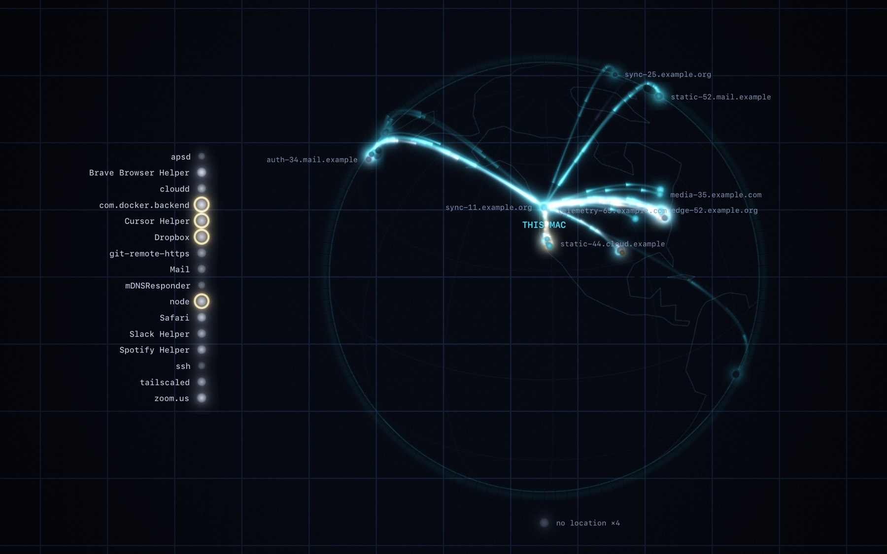
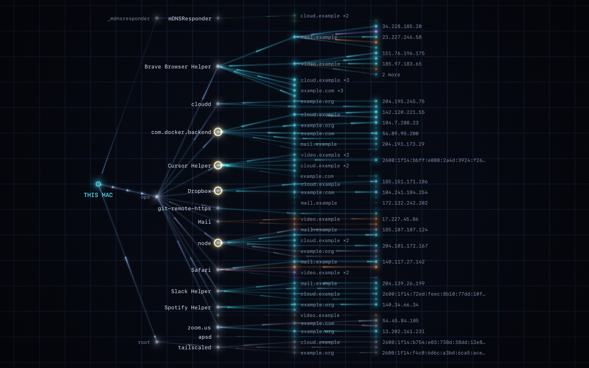
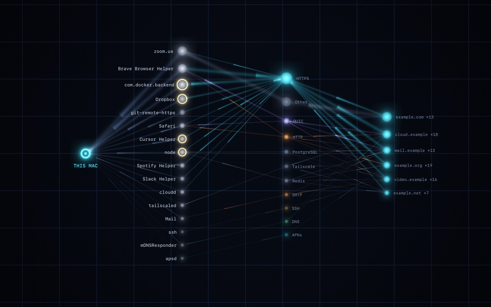
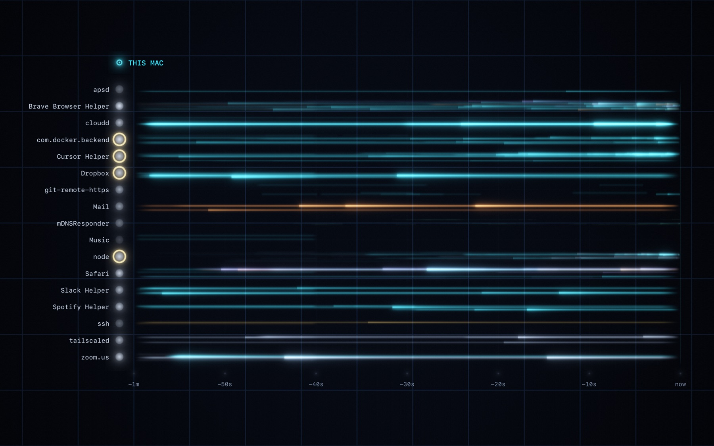

# M7 findings

Five ways to look at the same connections, named workspaces, and a kiosk mode for a wall display. Part one added flow and lanes, workspaces, and kiosk; part two added the globe and the hierarchy. Measured on macOS 27.2.1, Apple M4, release build.









All four pictures are simulated traffic, with invented places for the simulated addresses.

## Roadmap items

| Item | State |
|---|---|
| Sankey: process → service → organisation | Done, as the **flow** layout (below for how it differs from a textbook Sankey) |
| Swim lanes: per-process connection timelines | Done, as the **lanes** layout |
| Animated transitions that keep selection | Done: nodes glide to their new places and what was selected stays selected |
| Workspaces: save, restore, three defaults | Done: NOC Wall, Privacy Audit, Developer, and your own |
| Kiosk mode | Done |
| Multi-display placement | Written, **not tested**: this machine had one display |
| JSON import and export of configuration | Written, **not tested by hand** |
| Golden snapshots for each layout | Done: five reference pictures now |
| Globe: sphere, great-circle arcs, rate-weighted | Done, in part two (below) |
| Hierarchy view | Done, in part two (below) |

## How to use it

| | |
|---|---|
| Switch layout | The control in the top bar, keys **1** to **5**, or ⌘1 to ⌘5 |
| Where this Mac is, for the globe | Settings ▸ Globe; guessed from the time zone if left empty |
| Workspaces | The **Workspace** menu: pick one, or *Save Current as Workspace…* |
| Kiosk mode | **K**, or ⌃⌘K; **Esc** leaves |
| Next display | ⌃⌘D |
| Lanes time span | Settings ▸ Lanes layout: 1 minute to 1 hour |

From the command line, for a display that starts itself:

```bash
build/Switchboard.app/Contents/MacOS/Switchboard --workspace "NOC Wall" --display 2
```

`--layout flow`, `--kiosk`, and `--display N` also work on their own.

## Verification

> Each layout holds 60 fps at the busy-developer scenario.

| Layout | Frames per second | Slowest 1% of frames | Where |
|---|---|---|---|
| Flow | 119 | 13.8 ms | Live traffic, 74 connections, window with inspector |
| Lanes | 119 | 13.5 ms | Same |
| Constellation in kiosk | 118 | 23.0 ms | Simulated developer scenario, full screen at 5120×2880 |

The display refreshes at 120 Hz, so these are at its ceiling. On the 5,500-connection stress scenario the two new layouts take the same time to build as the constellation (about 5 s for 21 rebuilds each, dominated by work all three share), so neither adds a cost of its own.

> Selection survives every layout switch.

Tested: a selected process keeps its connections, its tooltip, and its highlight ring through constellation → flow → lanes → constellation, and is back within half a unit of where it started. A visit to the other layouts leaves the constellation as it was, and its three golden images are unchanged to the pixel.

> Golden snapshots for each layout.

`scripts/snapshots.sh` now compares five pictures: the three constellation scenes, flow, and lanes.

## Exit criterion

> NOC Wall workspace runs full screen on a second display for eight hours without intervention.

**Not met as written, and I cannot meet it from here.** What has been done instead:

- The NOC Wall workspace starts from the command line, goes full screen, hides everything but the graph, and draws at the display's refresh rate. Seen once, for ten seconds, on the built-in display.
- Eight simulated hours were run through each layout with no window, to check that nothing grows without limit. Results are in the table below.

| Layout | Simulated time | Connections at the end | Peak memory | Wall time |
|---|---|---|---|---|
| Constellation | 8 h | 286 | 57 MB | 100 s |
| Flow | 8 h | 286 | 60 MB | 149 s |
| Lanes, 10-minute span | 8 h | 286 | 95 MB | 606 s |

Ten simulated minutes of the constellation peak at 48 MB, so eight hours adds 9 MB there. Each run is 115,200 rebuilds of the scene, which makes one rebuild about 0.9 ms in the constellation, 1.3 ms in flow, and 5.3 ms in lanes. The app rebuilds twice a second, so even lanes is about 1% of one core.

Lanes costs more because it draws every connection of the last ten minutes as its own bar, some 3,000 of them in this scenario, where the other two draw one line per process and destination. Its memory is higher for the same reason and is bounded by the time span: connections that have slid off the left are forgotten.

What that does not show: eight real hours of the app with a window, the GPU, SwiftUI, and the log all running. That needs a real overnight run, and it needs a second display.

## Decisions

- **The layouts are arrangements, not separate views.** Flow and lanes place the same nodes the constellation uses, so picking, tooltips, the inspector, the filter, focus, and the tables work in all three with no code of their own, and switching is a glide.
- **Flow is not a strict Sankey.** Nodes are circles in four columns and ribbons are straight, with width following each ribbon's share of the bytes on screen. Ribbons do not stack edge to edge along a bar as a textbook Sankey's do, so widths compare well but do not sum visually.
- **"Organisation" falls back.** The right-hand column uses the network owner when a location database is loaded, else the domain a destination was reached by, else its /24 or /48. The domain is guessed from the name's shape (`api.eu.example.com` → `example.com`, `www.bbc.co.uk` → `bbc.co.uk`), not looked up in the public suffix list.
- **Small things are folded together.** Flow shows the 28 largest processes and 32 largest destinations and one node each for the rest; lanes shows the 40 busiest processes and at most 4,000 bars.
- **Lanes remember what ended.** While the lanes are showing, ended connections are kept so their bars stay until they slide off the left. That memory starts when you switch to lanes, and is dropped when you leave unless "keep ended connections" is on.
- **Volume in flow is total bytes**, not the current rate, so a long-lived connection weighs what it has carried.
- **Crowded lanes are dimmed.** A lane with hundreds of bars would otherwise add up to solid white.
- **A workspace holds** layout, profile, filter, which panel, whether the panel and inspector show, keep-ended, clustering, and kiosk. A saved workspace with a built-in name replaces it; deleting it restores the original.

## Faults found on the way

- **Nodes in a column could block each other for ever.** The constellation pushes overlapping nodes apart. In a column, two nodes swapping rank cannot go round each other, so each held the other short of its place. The push is now used only in the constellation.
- **This Mac never moved.** The node at the centre was exempt from the layout step, which was right when the centre was the only place it could be.
- **A collector test depended on luck.** It compared the client's model with the collector's as soon as any bytes arrived after the last tick, which could be the tail of the tick before. It failed steadily on this machine today, on the committed code as well, and now waits for the last tick. The collector itself was not at fault.
- **A reverse-lookup test from M6 timed out when the suite was busy.** Its wait is longer now.

- **Flow was seven times slower than it needed to be.** The first eight-hour run took 738 s. It was sorting nodes by the text Swift generates to describe them, which is slow; it now sorts by the same key the constellation uses, and takes 149 s.
- **Lanes kept ended connections it could no longer show**, up to the limit of 3,000 whatever the time span. They are now dropped as they leave the span.

## Not done, not verified

- **Moving to another display** is untested: there was only one.
- **Export and import of settings** have not been tried by hand. (Tests for them were added in M8.)
- **Saving, replacing, and deleting a workspace** through the menu have not been tried by hand. Applying a built-in one from the command line has.
- **The kiosk caption** (the name and totals, top left) does not appear in captures, and that is the capture's doing: the in-app window capture pastes the graph's own frame over the graph's area, covering any text that floats on it, as it does the tooltip. It has not been seen on screen.
- **Hiding the pointer and keeping the display awake** in kiosk mode are written and unobserved.
- **Pointer interaction in the new layouts** (hover, click, right-click on ribbons and bars) is covered by tests of what is under a point, not by hand.
- In lanes, the lane area does not use the full width of a wide window when there are many lanes: the layout is fitted by its height.

## Part two: globe and hierarchy

### The globe

An orthographic globe, as a photograph from far away would show it, turned to face this Mac and swaying slowly either side of it (about 34° each way over 160 s), so home never goes round the back. The Still profile holds it still. Each process-to-destination pair is an arc from home, rising higher the further it goes; several processes talking to one place fan out rather than lie on one another. Destinations round the back fade out, with their arcs and labels, and cannot be clicked.

- **The land** is a coarse outline of about 400 points, drawn by hand for Switchboard and kept in the source (`WorldOutline.swift`). Downloading a real coastline dataset needs your agreement, and I worked through the night without it. It is recognisable rather than accurate: no Black Sea, no Caspian, no Baltic islands, a simplified Indonesia. Natural Earth's public-domain 1:110m coastlines would be the obvious upgrade, as a bundled file or a fetch script like the GeoIP one; that is your call.
- **Places** come from the location database. Private addresses sit around home. Public addresses the database does not know share one node below the globe, "no location", and get no arc: a line from home to nowhere would cut across the whole globe.
- **Home** is guessed from the time zone (a table of about 80 zones, then the zone's offset), and can be set in Settings ▸ Globe. Switchboard never asks the network where it is.
- **Processes** stand in a column to the left, as a legend: lighting one lights its arcs.
- Simulated traffic now gets invented but plausible places and owners (Amazon in Ashburn, Google in Mountain View, and so on), always the same place for the same address. That is why the flow picture changed: its right-hand column now groups by owner.

### The hierarchy

Account → process → domain → address, as a tree read left to right. It has 64 rows; when that is not enough, the smallest things are folded into "more" rows. Every process shown gets at least its largest domain. Domains are then added largest first, and domains then open into up to four addresses each, while there are rows to spare. The domain is the registered part of the hostname, or failing that the /24 or /48, or the kind of address. Simulated processes now run under accounts (ops, root, _mdnsresponder, _postgres, _build), so the first level has something to show.

Each branch has a filter expression: right-click ▸ filter to this narrows the whole window to that branch. A test checks that each branch's filter selects at least what the branch holds, and exactly that for domains, addresses and accounts.

### Measured

| Layout | Frames per second | Slowest 1% | Where |
|---|---|---|---|
| Globe | 119 | 15.5 ms | Live traffic, 70 connections, real places |
| Hierarchy | 119 | 14.4 ms | Live traffic, 67 connections |

| Eight simulated hours | Peak memory | Wall time | One rebuild |
|---|---|---|---|
| Globe | 59 MB | 128 s | 1.1 ms |
| Hierarchy | 59 MB | 298 s | 2.6 ms |

The globe draws about 1,200 short lines for the grid and the land, re-projected every frame as it sways. That costs nothing measurable at this size.

### A fault from M6, found by the globe

**The app never gave the location database to the engine.** Settings are first applied before the live feed exists. The M6 code marked the databases as loaded then, with nothing to hand them to, and so never tried again. `sbctl geo` worked, which is how the M6 checks passed. In the app, connections had no country, no owner and no place. The globe showed every destination as "no location", which gave it away. The databases are now handed over once the feed exists.

### Not done, not verified

- The location of a connection is not written to the log, so the globe of a past moment replayed from the log puts its destinations under "no location". Country and owner are logged.
- Dragging to turn the globe is not built; it sways on its own, or holds still.
- The selection-survives check for the globe and hierarchy is for processes. A selected address in the constellation has no node of its own in the hierarchy, where addresses are per process, so that selection does not carry into it.

## Tests

196 pass. 22 are new for this milestone: 11 in part one and 11 in part two. The suite takes about 14 seconds. Seven golden images: three constellation scenes, flow, lanes, globe, hierarchy.
